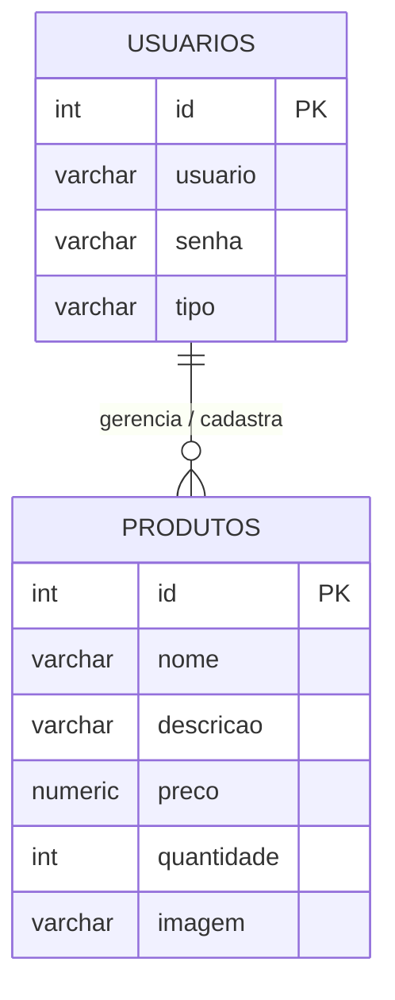

# ⚡ PokéStore - Sistema de Gestão e Vendas de Produtos Pokémon

## 1. Apresentação do Projeto

A **PokéStore** é uma aplicação web desenvolvida em PHP com integração ao banco de dados relacional PostgreSQL. O sistema foi concebido para atuar como uma loja virtual de cartas e itens colecionáveis do universo Pokémon, oferecendo uma vitrine para consulta de produtos por clientes e um painel administrativo para gerenciamento do catálogo.

A plataforma conta com páginas de apresentação, navegação de produtos, autenticação de usuários (clientes e administradores), além das operações fundamentais de **CRUD** (Criar, Ler, Atualizar e Deletar) para a gestão das cartas e estoque.

## 2. Como Executar o Projeto

Para executar a aplicação localmente ou em um servidor Linux de testes, é necessário ter instalado o servidor web Nginx, o PHP e o banco de dados PostgreSQL.

### 2.1 Pré-Requisitos

* **PHP** (v7.4 ou superior) habilitado com as extensões `pdo_pgsql` e `mbstring`.
* **PostgreSQL** em execução na porta padrão `5432`.
* **Nginx** instalado e configurado.
* **Git** para clonagem do repositório.

### 2.2 Passo 1: Clonar o Repositório

Abra o terminal e execute os comandos:

```bash
git clone https://github.com/HenriqueMartines/pokestore.git
cd pokestore
```

### 2.3 Passo 2: Configurar o Banco de Dados (PostgreSQL)

1. Conecte-se ao terminal do PostgreSQL com o usuário `postgres`:

   ```bash
   sudo -u postgres psql
   ```

2. Crie o banco de dados `pokemon_store`:

   ```sql
   CREATE DATABASE pokemon_store;
   \q
   ```

3. Importe a estrutura e os dados do arquivo `pokemon_store.sql` localizado na raiz do projeto:

   ```bash
   psql -U postgres -d pokemon_store -f pokemon_store.sql
   ```

### 2.4 Passo 3: Configurar Permissões de Pastas e Uploads (IMPORTANTE)

Para garantir que o servidor web consiga gravar as fotos dos produtos enviados pelo painel de administração na pasta `imagens/` sem erros de acesso negado:

```bash
# Define o usuário do Nginx (www-data) como proprietário do diretório
sudo chown -R www-data:www-data /var/www/html

# Concede permissões de leitura, escrita e execução
sudo chmod -R 775 /var/www/html
```

### 2.5 Passo 4: Configurar a Conexão no PHP

O arquivo de conexão encontra-se em `config/conexao.php`. Verifique se os dados do seu banco coincidem com o trecho configurado no código:

```php
<?php
$host     = "localhost"; // Ou o IP da máquina do servidor
$port     = "5432";
$database = "pokemon_store";
$usuario  = "postgres";
$senha    = "011625";

define('BASE_URL', 'http://' . $_SERVER['HTTP_HOST'] . '/');

try {
    $conexao = new PDO("pgsql:host=$host;port=$port;dbname=$database", $usuario, $senha);
} catch (PDOException $e) {
    echo "Erro ao conectar com o banco de dados.";
}
?>
```

### 2.6 Passo 5: Acessar a Aplicação e Credenciais de Teste

Com o serviço do Nginx rodando, abra o seu navegador e acesse a aplicação pelo IP da máquina ou por `localhost`:

* **Endereço de acesso:** `http://<IP_DO_SERVIDOR>/` ou `http://localhost/`
* **Credenciais do Administrador Padrão:**
  * **Usuário:** `admin`
  * **Senha:** `1234`
* **Usuário Cliente:** Pode ser criado na própria tela de cadastro do sistema (`login/cadastrar.php`).

## 3. Especificação de Requisitos de Software (SRS)

### 3.1 Classes de Usuários

| Tipo de Usuário | Descrição e Permissões | 
| ----- | ----- | 
| **Visitante / Cliente** | Pode navegar pela vitrine principal, visualizar os detalhes dos produtos e criar uma conta pública. | 
| **Administrador** | Usuário com permissão especial (`tipo = 'admin'`) que possui acesso às telas de gerenciamento (adicionar, editar e apagar cartas e produtos). | 

### 3.2 Requisitos Funcionais (RF)

| ID | Título | Descrição | Prioridade | 
| ----- | ----- | ----- | ----- | 
| **RF01** | Cadastro de Usuários | O sistema deve permitir que novos clientes criem uma conta informando nome de usuário e senha. | Alta | 
| **RF02** | Login e Autenticação | O sistema deve autenticar usuários cadastrados e abrir uma sessão válida. | Alta | 
| **RF03** | Controle de Acesso | O sistema deve restringir o acesso à pasta `admin/` apenas para usuários com o perfil `admin`. | Alta | 
| **RF04** | Encerramento de Sessão (Logout) | O sistema deve disponibilizar funcionalidade para encerrar a sessão ativa. | Alta | 
| **RF05** | Vitrine de Produtos | O sistema deve listar as cartas e produtos salvos no banco de dados na página inicial. | Alta | 
| **RF06** | Cadastro de Produtos | O sistema deve permitir que o administrador cadastre novos produtos com nome, descrição, preço, quantidade e foto. | Alta | 
| **RF07** | Edição de Produtos | O sistema deve permitir alterar os dados de um produto existente e atualizar sua imagem. | Alta | 
| **RF08** | Exclusão de Produtos | O sistema deve permitir ao administrador remover produtos do catálogo e do banco de dados. | Alta | 
| **RF09** | Upload de Imagens | O sistema deve processar o envio de arquivos de imagem e armazená-los na pasta `imagens/`. | Alta | 

### 3.3 Requisitos Não Funcionais (RNF)

| ID | Título | Descrição | Prioridade | 
| ----- | ----- | ----- | ----- | 
| **RNF01** | Tecnologias | O sistema deve ser desenvolvido em PHP com banco de dados PostgreSQL. | Alta | 
| **RNF02** | Conexão Segura | As consultas ao banco de dados devem ser executadas via extensão PDO (`pgsql`). | Alta | 
| **RNF03** | Endereçamento Dinâmico | O sistema deve construir as URLs usando `$_SERVER['HTTP_HOST']` para funcionar em qualquer IP de rede. | Alta | 
| **RNF04** | Interface Responsiva | O layout deve ser estilizado via arquivo CSS próprio (`style.css`). | Média | 

### 3.4 Regras de Negócio (RN)

| ID | Título | Regra / Condição | 
| ----- | ----- | ----- | 
| **RN01** | Acesso Administrativo | Somente usuários identificados com `tipo = 'admin'` na sessão podem acessar as ferramentas em `admin/`. | 
| **RN02** | Perfil Inicial | Todo cadastro feito pelo formulário público (`cadastrar.php`) recebe automaticamente o tipo `cliente`. | 
| **RN03** | Preço e Estoque | O campo preço não pode conter valores negativos e a quantidade do produto deve ser um inteiro válido. | 
| **RN04** | Integridade dos Arquivos | As fotos de produtos enviados devem ser renomeadas via código antes de salvas para evitar sobrescrever imagens com nomes iguais. | 

## 4. Product Backlog

| ID | Item | Descrição | Prioridade | Status | 
| ----- | ----- | ----- | ----- | ----- | 
| **PB01** | Modelagem do Banco | Criar a estrutura das tabelas `usuarios` e `produtos` no PostgreSQL. | Alta | Concluído | 
| **PB02** | Script de Conexão | Implementar a conexão via PDO no arquivo `config/conexao.php`. | Alta | Concluído | 
| **PB03** | Tela de Login e Cadastro | Criar formulários e lógica para autenticação e criação de contas. | Alta | Concluído | 
| **PB04** | Vitrine de Produtos | Desenvolver as telas `index.php` e `produtos.php` para exibição dos produtos cadastrados. | Alta | Concluído | 
| **PB05** | Painel Admin (CRUD) | Desenvolver as telas de adicionar, editar e excluir produtos. | Alta | Concluído | 
| **PB06** | Sistema de Uploads | Criar o manipulador `uploads.php` para envio e salvamento de imagens. | Alta | Concluído | 
| **PB07** | Configuração do Servidor | Ajustar permissões `chown` e `chmod` no Nginx para gravação de arquivos no Linux. | Alta | Concluído | 

## 5. Estrutura do Projeto

```text
pokestore/
├── admin/
│   ├── adicionar.php     # Formulário e lógica de cadastro de novos produtos
│   ├── editar.php        # Formulário e lógica de alteração de produtos
│   ├── excluir.php       # Script de remoção de produtos
│   └── index.php         # Painel principal da administração
├── config/
│   └── conexao.php       # Arquivo de conexão com o banco PostgreSQL (PDO)
├── css/
│   └── style.css         # Estilização visual da aplicação
├── imagens/              # Diretório onde as imagens dos produtos ficam salvas
├── includes/
│   ├── footer.php        # Rodapé padrão incluído nas páginas
│   ├── functions.php     # Funções auxiliares, validações e controle de sessão
│   └── header.php        # Cabeçalho e menu principal do site
├── login/
│   ├── cadastrar.php     # Tela de cadastro para novos usuários
│   ├── login.php         # Tela de login e autenticação
│   └── logout.php        # Script para encerrar a sessão do usuário
├── index.php             # Página inicial / Vitrine do site
├── pokemon_store.sql     # Script SQL de criação do banco e dados iniciais
├── produtos.php          # Página de exibição do catálogo de produtos
├── README.md             # Documentação completa do projeto
└── uploads.php           # Script responsável pelo processamento dos arquivos de imagem
```

## 6. Estruturação do Banco de Dados e Dicionário de Dados

O banco de dados `pokemon_store` possui duas tabelas principais no schema `public`.

### 6.1 Tabela: `usuarios`

Armazena as contas registradas no sistema e o tipo de permissão de acesso.

| Campo | Código | Tipo | Tamanho | Restrições | Descrição | 
| ----- | ----- | ----- | ----- | ----- | ----- | 
| **ID** | `id` | INTEGER | - | Primary Key, Auto Increment | Identificador único do usuário. | 
| **Usuário** | `usuario` | VARCHAR | 50 | NOT NULL | Nome/Login utilizado para autenticação. | 
| **Senha** | `senha` | VARCHAR | 50 | NOT NULL | Senha do usuário. | 
| **Tipo** | `tipo` | VARCHAR | 20 | NOT NULL | Define a permissão (`admin` ou `cliente`). | 

### 6.2 Tabela: `produtos`

Armazena as cartas e artigos Pokémon cadastrados para venda na loja.

| Campo | Código | Tipo | Tamanho | Restrições | Descrição | 
| ----- | ----- | ----- | ----- | ----- | ----- | 
| **ID** | `id` | INTEGER | - | Primary Key, Auto Increment | Identificador único do produto. | 
| **Nome** | `nome` | VARCHAR | 100 | NOT NULL | Nome da carta ou produto. | 
| **Descrição** | `descricao` | VARCHAR | 255 | NULL | Descrição com detalhes sobre o produto. | 
| **Preço** | `preco` | NUMERIC | (10,2) | NOT NULL | Valor de venda em Reais (R$). | 
| **Quantidade** | `quantidade` | INTEGER | - | NOT NULL | Quantidade do item disponível em estoque. | 
| **Imagem** | `imagem` | VARCHAR | 255 | NULL | Caminho/nome do arquivo de foto salvo na pasta `imagens/`. | 

## 7. Diagramas

### 7.1 Diagrama Entidade-Relacionamento (DER)

O DER abaixo representa a estrutura das entidades `USUARIOS` e `PRODUTOS` do sistema PokéStore e a relação de gerenciamento mantida pelo perfil administrativo.



## 8. Considerações Finais

O desenvolvimento da **PokéStore** permitiu aplicar na prática conceitos de arquitetura web em PHP, integração com o SGBD PostgreSQL e gerenciamento de infraestrutura Linux em servidores Nginx.

A estruturação flexível da aplicação garante que ela possa ser facilmente clonada, implantada e executada sob qualquer endereço IP de rede local ou remota, oferecendo uma experiência fluida tanto para clientes navegantes quanto para os administradores da loja.
